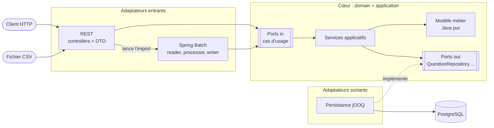
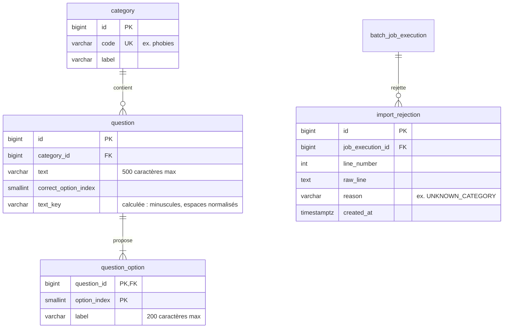

# quizapp

[](https://github.com/Maeva-RODRIGUES/quizapp/actions/workflows/ci.yml)
[](https://sonarcloud.io/summary/new_code?id=Maeva-RODRIGUES_quizapp)
[](https://sonarcloud.io/summary/new_code?id=Maeva-RODRIGUES_quizapp)

API REST de quiz en Java / Spring Boot, autour de deux catégories décalées :
**Superstitions étranges** et **Phobies étranges**. On liste les questions, on soumet ses réponses, l'API corrige
et calcule le score. On peut aussi **importer des questions depuis un fichier CSV** : un job Spring Batch
applique des règles de qualité des données et produit un rapport des lignes rejetées.

> Né en 2024 comme prototype minimal, le projet a été entièrement refondu autour d'une stack orientée données :
> PostgreSQL, Liquibase, jOOQ, Spring Batch, architecture hexagonale, tests d'intégration Testcontainers,
> Docker, CI et analyse de qualité.

## En bref

| | |
|---|---|
| Langage / framework | Java 21, Spring Boot 4.1, Maven |
| Base de données | PostgreSQL 18, schéma versionné avec Liquibase, contraintes de qualité en SQL (`CHECK`, unicité) |
| Accès aux données | jOOQ, avec du code généré à partir du schéma réel |
| Architecture | hexagonale (*ports & adapters*), vérifiée à chaque build par ArchUnit |
| API | REST, entrées validées, erreurs au format *Problem Details* (RFC 9457) |
| Import de données | job Spring Batch **asynchrone** : validation, dédoublonnage, rapport des rejets, compteurs |
| Tests | 244 tests : unitaires (JUnit 5, Mockito), `@WebMvcTest`, intégration sur un vrai PostgreSQL (Testcontainers) |
| Livraison | image Docker multi-stage non-root, CI GitHub Actions, couverture JaCoCo, analyse SonarCloud |

## Démarrage rapide

Prérequis :

- un JDK 21 ou plus récent (Maven n'est pas nécessaire, le wrapper `./mvnw` est fourni) ;
- Docker avec Docker Compose, **y compris pour compiler** :
  - la génération du code jOOQ démarre un PostgreSQL éphémère et y applique les changelogs Liquibase ;
  - les tests d'intégration utilisent un PostgreSQL éphémère (Testcontainers) ;
  - `./mvnw spring-boot:run` démarre automatiquement PostgreSQL (`compose.yaml`, port local 5433).

```bash
# Compiler et lancer les tests (rapport de couverture : target/site/jacoco/index.html)
./mvnw verify

# Démarrer l'application (port 8080) avec les questions de démo
./mvnw spring-boot:run -Dspring-boot.run.profiles=local

# Essayer
curl -s http://localhost:8080/api/categories
```

Le profil `local` ajoute les 10 questions de démonstration en base. Sans lui, seules les catégories
de référence sont chargées.

Pour explorer la base :

```bash
docker compose exec postgres psql -U quizapp -d quizapp
```

### Lancer l'application dans Docker

L'image est construite à partir du jar produit par Maven (multi-stage : JRE seul, utilisateur non-root,
couches séparées pour que les dépendances restent en cache) :

```bash
./mvnw package
docker compose --profile app up --build    # application (port 8080) + PostgreSQL, avec les questions de démo
docker compose --profile app down          # arrêt (les données sont conservées dans le volume)
```

Sans `--profile app`, `docker compose up` ne démarre que PostgreSQL, comme `./mvnw spring-boot:run`.

## Architecture

Architecture hexagonale (*ports & adapters*) : le métier est au centre, les détails techniques autour.
Les dépendances pointent toujours vers le centre, et des règles ArchUnit le vérifient à chaque build
(par exemple : le package `domain` ne dépend que de lui-même et de la bibliothèque standard Java).



```
io.github.maevarodrigues.quizapp
├── domain                  cœur métier, Java pur
│   ├── model               Category, Question, QuestionKey, QuizSubmission, QuizResult, ImportReport…
│   ├── exception           erreurs métier
│   └── port
│       ├── in              cas d'usage offerts (ListCategoriesUseCase, SubmitQuizUseCase, ImportQuestionsUseCase…)
│       └── out             besoins vers l'extérieur (QuestionRepository, CategoryRepository, ImportRejectionRepository)
├── application             services qui implémentent les ports « in » à l'aide des ports « out »
├── adapters
│   ├── in/web              controllers REST, DTO, gestion des erreurs : n'appellent que les ports « in »
│   ├── in/batch            job d'import CSV : lecture, règles de qualité, écriture, rapport des rejets
│   └── out/persistence     implémentations jOOQ des ports « out » (+ code jOOQ généré)
└── config                  assemblage des beans Spring, exécution asynchrone des imports
```

## Modèle de données

Le schéma est entièrement décrit par les changelogs Liquibase (`src/main/resources/db/changelog`).
Les tables techniques de Spring Batch (`batch_*`) y sont aussi versionnées.



La base protège la qualité des données même si le code oubliait une règle :

- code de catégorie unique et au format `minuscules-et-tirets` ;
- énoncés et réponses non vides, index positifs (`CHECK`) ;
- **unicité de `(category_id, text_key)`** : deux questions qui ne diffèrent que par la casse ou les espaces
  sont considérées comme des doublons ;
- suppression en cascade des réponses avec leur question, et des rejets avec leur exécution d'import.

## Import et qualité des données

L'import de questions est un **job Spring Batch** : le fichier est lu ligne par ligne, chaque ligne passe
des **règles de qualité**, et les questions valides sont écrites en base par paquets de 100, chacun dans une transaction.
Une ligne invalide n'arrête pas l'import : elle est **rejetée**, et consignée avec son numéro, son contenu et son motif.

Format attendu (UTF-8, séparateur `;`, en-tête obligatoire, de 2 à 4 réponses, bonne réponse numérotée **à partir de 1**) :

```
category;question;option_1;option_2;option_3;option_4;correct_option
phobies;Comment appelle-t-on la peur des clowns ?;Coulrophobie;Clinophobie;Cynophobie;;1
```

| Motif | Règle |
|---|---|
| `MALFORMED_LINE` | la ligne n'a pas exactement 7 colonnes |
| `UNKNOWN_CATEGORY` | la catégorie n'existe pas dans le référentiel |
| `EMPTY_TEXT` / `TEXT_TOO_LONG` | énoncé vide / de plus de 500 caractères |
| `TOO_FEW_OPTIONS` | moins de 2 réponses |
| `OPTIONS_NOT_CONTIGUOUS` | colonne de réponse vide suivie d'une réponse remplie |
| `OPTION_TOO_LONG` / `DUPLICATE_OPTIONS` | réponse de plus de 200 caractères / deux réponses identiques |
| `CORRECT_OPTION_NOT_A_NUMBER` / `CORRECT_OPTION_OUT_OF_RANGE` | numéro de bonne réponse illisible / sans réponse correspondante |
| `DUPLICATE_IN_FILE` | même question plus haut dans le fichier (casse et espaces ignorés) |
| `ALREADY_EXISTS` | même question déjà en base |

Une ligne peut être rejetée pour plusieurs motifs à la fois. Un en-tête incorrect fait échouer tout l'import (statut `FAILED`).

Essai avec le fichier d'exemple [`samples/questions-import.csv`](samples/questions-import.csv), qui contient des erreurs volontaires.

L'import est **asynchrone** : la requête répond tout de suite `202 Accepted`, avec l'URL de suivi dans l'en-tête
`Location`, et le fichier est traité en arrière-plan (au plus 2 imports en parallèle, les suivants attendent leur tour).

```bash
curl -si -F file=@samples/questions-import.csv http://localhost:8080/api/imports
```

```
HTTP/1.1 202
Location: http://localhost:8080/api/imports/1

{"executionId": 1, "status": "STARTING", "startTime": null, "endTime": null, "read": 0, "written": 0, "rejected": 0}
```

On suit l'avancement (les compteurs progressent à chaque paquet de 100 lignes) jusqu'à `COMPLETED` ou `FAILED` :

```bash
curl -s http://localhost:8080/api/imports/1
```

```json
{"executionId": 1, "status": "COMPLETED", "startTime": "2026-11-06T19:25:45", "endTime": "2026-11-06T19:25:45",
 "read": 12, "written": 5, "rejected": 7}
```

Puis on consulte le rapport de qualité :

```bash
curl -s http://localhost:8080/api/imports/1/rejections
```

```json
[
  {"lineNumber": 7, "reason": "ALREADY_EXISTS", "rawLine": "phobies;QUEL est le nom de la peur des araignées ?;Arachnophobie;Entomophobie;;;1"},
  {"lineNumber": 8, "reason": "UNKNOWN_CATEGORY", "rawLine": "astrologie;Quel est l'élément du signe du Bélier ?;Feu;Eau;Air;Terre;1"},
  {"lineNumber": 12, "reason": "MALFORMED_LINE", "rawLine": "phobies;Ligne incomplète;Oui;Non"}
]
```

(extrait ; réimporter le même fichier n'écrit rien : toutes les lignes valides sont alors `ALREADY_EXISTS`)

Le statut et les compteurs ne sont pas recalculés : ils sont lus dans les tables de Spring Batch (`batch_job_execution`,
`batch_step_execution`), et le rapport dans `import_rejection`. Le fichier reçu est supprimé à la fin de l'import.

## API

| Méthode | URL | Description |
|---|---|---|
| `GET` | `/api/categories` | catégories disponibles |
| `GET` | `/api/questions` | toutes les questions |
| `GET` | `/api/questions?category=phobies` | questions d'une catégorie (par son code) |
| `POST` | `/api/quiz/submit` | corrige les réponses au quiz d'une catégorie |
| `POST` | `/api/imports` | lance l'import d'un fichier CSV de questions, en arrière-plan (voir [Import et qualité des données](#import-et-qualité-des-données)) |
| `GET` | `/api/imports/{id}` | état d'un import : statut, dates, compteurs |
| `GET` | `/api/imports/{id}/rejections` | lignes rejetées par un import, avec leur motif |

Les questions sont renvoyées **sans la bonne réponse** : elle n'est révélée qu'après soumission.

```bash
curl -s http://localhost:8080/api/categories
```

```json
[
  {"code": "superstitions", "label": "Superstitions étranges"},
  {"code": "phobies", "label": "Phobies étranges"}
]
```

```bash
curl -s "http://localhost:8080/api/questions?category=phobies"
```

```json
[
  {
    "id": 6,
    "category": "phobies",
    "text": "Quel est le nom de la peur des araignées ?",
    "options": ["Entomophobie", "Myrmécophobie", "Arachnophobie"]
  }
]
```

Soumettre un quiz : `answers` associe l'id de chaque question à l'index de la réponse choisie (à partir de 0).
Le quiz comprend **toutes** les questions de la catégorie : une question sans réponse compte comme fausse.

```bash
curl -s -X POST http://localhost:8080/api/quiz/submit \
  -H 'Content-Type: application/json' \
  -d '{"category": "phobies", "answers": {"6": 2, "7": 1}}'
```

```json
{
  "score": 1,
  "total": 5,
  "corrections": [
    {"questionId": 6, "givenOptionIndex": 2, "correctOptionIndex": 2, "correct": true},
    {"questionId": 7, "givenOptionIndex": 1, "correctOptionIndex": 0, "correct": false},
    {"questionId": 8, "givenOptionIndex": null, "correctOptionIndex": 1, "correct": false}
  ]
}
```

(extrait : une correction par question de la catégorie)

### Erreurs

Toutes les erreurs suivent le format *Problem Details* (RFC 9457, `Content-Type: application/problem+json`) :

| Cas | Statut |
|---|---|
| requête invalide (champ manquant, index négatif, JSON illisible…) | `400`, avec la liste des champs en cause dans `errors` |
| soumission incohérente (question hors du quiz, réponse inexistante) | `400` |
| catégorie ou import inconnu, route inexistante | `404` |
| `Content-Type` autre que JSON | `415` |
| erreur inattendue | `500`, sans détail technique (la cause est dans les logs) |

```bash
curl -s "http://localhost:8080/api/questions?category=inconnue"
```

```json
{
  "title": "Unknown category",
  "status": 404,
  "detail": "unknown category: inconnue",
  "instance": "/api/questions"
}
```

```bash
curl -s -X POST http://localhost:8080/api/quiz/submit \
  -H 'Content-Type: application/json' \
  -d '{"category": " ", "answers": {}}'
```

```json
{
  "title": "Invalid request",
  "status": 400,
  "detail": "The request contains invalid fields.",
  "instance": "/api/quiz/submit",
  "errors": [
    {"field": "answers", "message": "must not be empty"},
    {"field": "category", "message": "must not be blank"}
  ]
}
```

Les messages de validation sont traduits selon l'en-tête `Accept-Language` (par défaut, la langue du serveur).

## Choix techniques

**jOOQ plutôt que JPA / Hibernate.**
L'application manipule des données plus qu'elle ne fait vivre un graphe d'objets : elle lit des questions,
contrôle des doublons et écrit des lots. jOOQ permet d'écrire du SQL explicite, vérifié à la compilation, car
le code est généré à partir du vrai schéma : renommer une colonne casse le build, pas la production.
Il n'y a pas de chargement paresseux ni de requêtes cachées. Exemple : les questions et leurs réponses
sont lues en **une seule requête** grâce à `MULTISET`, sans problème « N+1 ».

**Liquibase plutôt qu'un script `data.sql`.**
Le schéma évolue par changelogs versionnés, appliqués une seule fois, dans l'ordre, et tracés en base.
Les mêmes changelogs servent partout : en local, dans les tests, en CI et pour générer le code jOOQ.
Les données de démonstration sont isolées par un *context* (`demo`) et n'arrivent jamais en production par accident.

**Testcontainers plutôt que H2.**
H2 imite PostgreSQL sans en être un : les contraintes `CHECK` en expressions régulières, les colonnes calculées,
`MULTISET` ou les tables de Spring Batch se comporteraient différemment. Les tests d'intégration tournent
donc sur un vrai PostgreSQL 18 jetable : ce qui passe en test passe en production.

**Architecture hexagonale.**
Le métier (correction d'un quiz, invariants d'une question) est en Java pur, testable en millisecondes,
sans Spring ni base. Les détails techniques sont des adaptateurs : l'API REST et le job Batch passent par
des ports (cas d'usage), jamais directement par la base, et la persistance jOOQ pourrait être remplacée sans
toucher au métier. ArchUnit fait respecter la règle à chaque build, pour qu'elle ne reste pas une simple intention.

**Spring Batch pour l'import.**
Un import de données n'est pas une simple boucle : il faut des transactions par paquets, la tolérance aux
lignes invalides (*skip*), des compteurs et un historique des exécutions. Spring Batch fournit tout cela et
le stocke dans ses tables. Les règles de qualité sont regroupées dans un validateur testé unitairement,
qui liste **tous** les problèmes d'une ligne plutôt que le premier trouvé.

**Qualité des données à deux niveaux.**
Le validateur produit des rejets explicables (motif, numéro de ligne, contenu brut) ; la base garde le dernier mot
avec ses contraintes. La clé de dédoublonnage est normalisée de la même façon en Java et en SQL, et un test
d'intégration vérifie que les deux restent d'accord.

**Import asynchrone.**
Un gros fichier ne doit pas bloquer une requête HTTP jusqu'au *timeout*. L'API répond `202 Accepted` avec l'URL
de suivi, et le job tourne sur un pool de threads borné (2 imports en parallèle, file d'attente limitée).

## Tests

```bash
./mvnw test      # tests unitaires seulement (Docker reste requis pour générer le code jOOQ)
./mvnw verify    # tous les tests, y compris l'intégration (Docker requis), et rapport de couverture
```

| Type | Outils | Ce qui est vérifié |
|---|---|---|
| Unitaires (`*Test`) | JUnit 5, AssertJ, Mockito | modèle métier, services, règles de qualité de l'import |
| Architecture | ArchUnit | sens des dépendances entre `domain`, `application` et `adapters` |
| Web | `@WebMvcTest`, MockMvc | routes, validation, format des erreurs, DTO sans la bonne réponse |
| Intégration (`*IT`) | Testcontainers (PostgreSQL 18), Awaitility | changelogs Liquibase, requêtes jOOQ, job Batch de bout en bout, API complète |

La CI (GitHub Actions) lance `./mvnw verify` à chaque push, publie les rapports de tests en cas d'échec,
construit l'image Docker et envoie couverture et analyse à SonarCloud.

## Limites connues

- Un import interrompu par un arrêt brutal de l'application reste au statut `STARTED` : il n'y a pas encore
  de reprise ni de nettoyage automatique de ces exécutions.
- Les dates d'import sont stockées par Spring Batch sans fuseau horaire (`LocalDateTime`) : elles suivent le fuseau
  du serveur (UTC dans le conteneur Docker).
- Le dédoublonnage interroge la base une fois par ligne : c'est suffisant pour quelques milliers de lignes,
  mais un très gros fichier demanderait des vérifications groupées.
- Pas d'authentification : n'importe qui peut lancer un import. Pas de *health check* applicatif (Actuator).

## Feuille de route

- [x] **Phase 0** : réparer le build, documenter l'état du projet
- [x] **Phase 1** : passer à Java 21 et à une version maintenue de Spring Boot, nettoyer le contenu des questions, intégration continue
- [x] **Phase 2** : PostgreSQL avec Docker Compose, schéma et données de référence avec Liquibase
- [x] **Phase 3** : modèle de domaine hexagonal, tests unitaires et règles d'architecture
- [x] **Phase 4** : persistance avec jOOQ, tests d'intégration Testcontainers
- [x] **Phase 5** : API complète (catégories, questions par catégorie, soumission et score), validation, gestion d'erreurs
- [x] **Phase 6** : job Spring Batch d'import CSV avec règles de qualité des données
- [x] **Phase 7** : Dockerfile, intégration continue, SonarCloud
- [ ] **Phase 8** : documentation finale, licence
- [ ] **Bonus** : front Angular minimal, déploiement AWS décrit en Terraform
